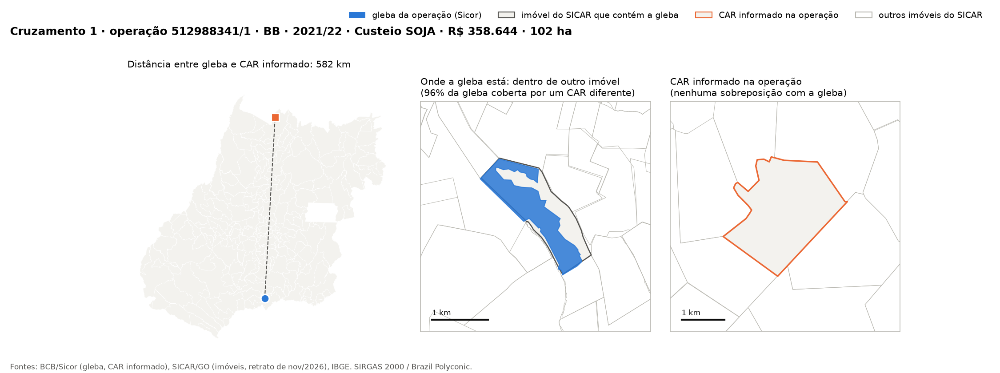
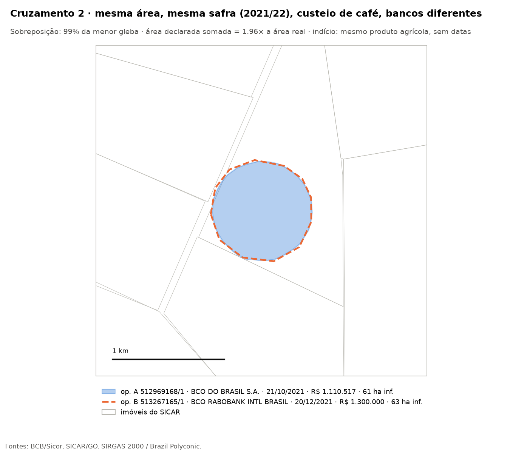
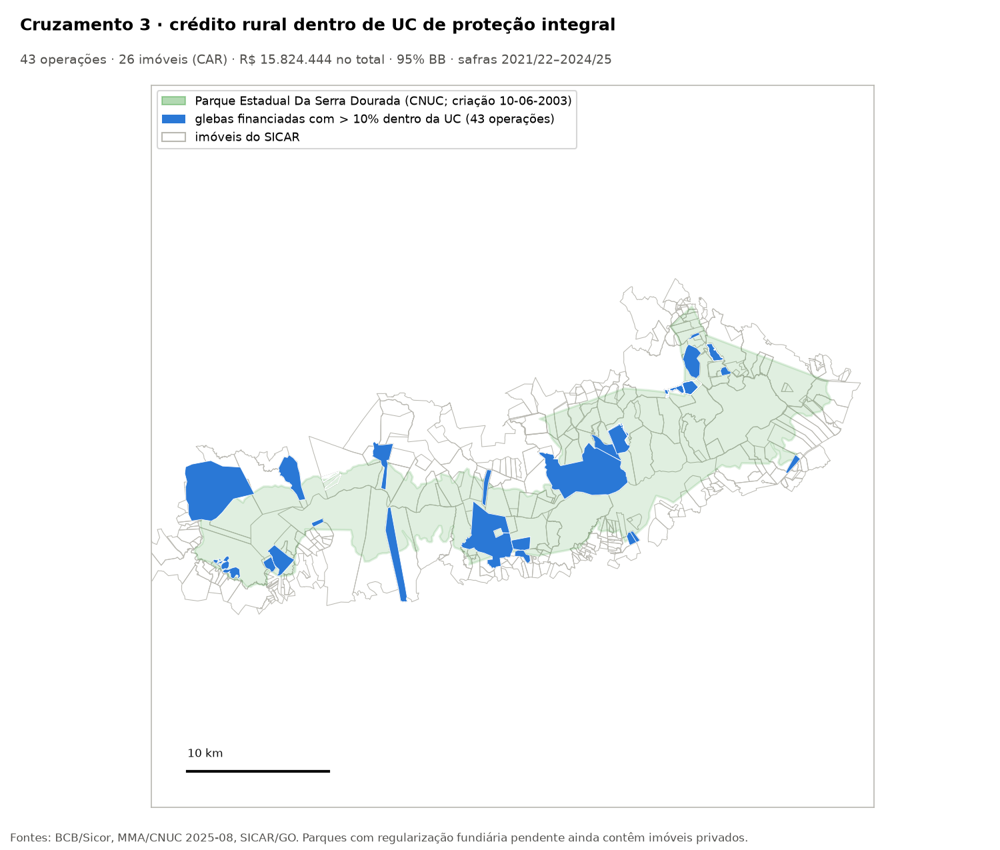
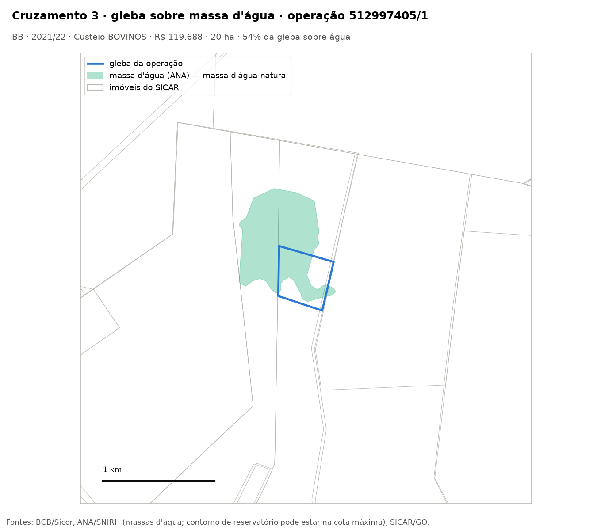
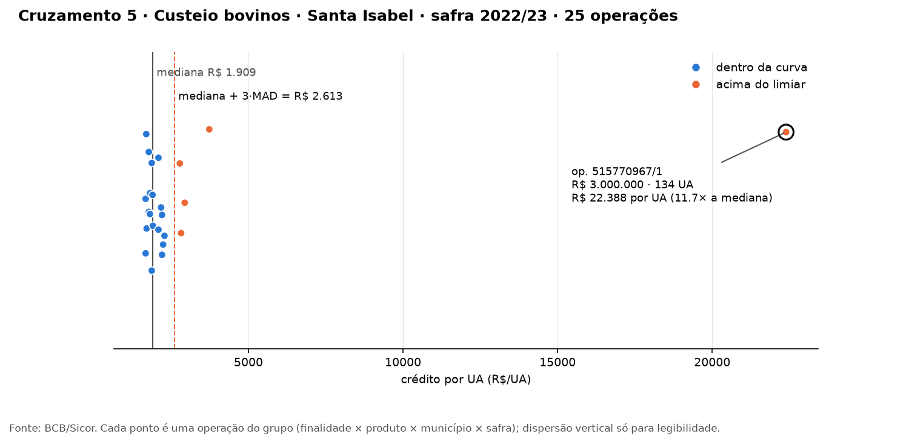

# Crédito rural em Goiás: triagem por cruzamento de bases públicas

*Exploração pessoal de fim de semana (nov/2026). Triagem, não acusação: cada caso listado é uma inconsistência entre bases públicas, com várias explicações possíveis além de irregularidade. Sem nomes nem CPF; operações identificadas pelo `REF_BACEN` mascarado do BCB.*

## Resumo

- **Recorte:** 240.284 operações de custeio e investimento em Goiás, safras 2021/22–2024/25, R$ 118,1 bi. BB = 77% das operações.
- **Só 34% das operações têm gleba publicada** (20% do valor), com viés forte para pequeno produtor, Pronaf, pecuária e BB. Os cruzamentos geométricos valem para esse subconjunto.
- **Sinais que parecem reais:** gleba fora do CAR informado (3.181 operações); crédito dentro de UC de proteção integral (63, concentradas no PE da Serra Dourada) e em área embargada vigente (9 por polígono); mesma área financiada na mesma safra em bancos diferentes (802).
- **Ruído ou erro de cadastro:** área incoerente (quase tudo área simbólica de 0,01 ha ou alqueire digitado como hectare), fora do município (o Sicor já valida), água (aquicultura, arroz de várzea, lagoa sazonal), sobreposição em pecuária no mesmo banco (a área é reaproveitada; o crédito é por cabeça) e boa parte do valor/ha (confinamento, teto de R$ 3 mi).
- **Convergência:** 335 operações acumulam indício em ≥ 2 cruzamentos — é a lista de triagem mais útil (`cruzamentos/convergencia.csv`).
- **Vale um projeto maior?** Vale um **passo intermediário**, não um projeto grande só com dados públicos — ver a conclusão.

## 1. Recorte e cobertura de localização

|                                    | Total           | BB             | Demais         |
|:-----------------------------------|:----------------|:---------------|:---------------|
| Operações (custeio + investimento) | 240.284         | 185.540        | 54.744         |
| Valor (R$ bi)                      | 118,1           | 73,9           | 44,1           |
| Com gleba (polígono)               | 82.552 (34,4%)  | 73.470 (39,6%) | 9.082 (16,6%)  |
| Com CAR informado                  | 104.624 (43,5%) | 92.027 (49,6%) | 12.597 (23,0%) |
| Com município no complemento       | 105.822         | 92.220         | 13.602         |

O BCB publica gleba, CAR e município para o mesmo subconjunto de operações (toda operação com gleba tem CAR e município). A cobertura é de 56% para pequenos produtores e 22–27% para médios e grandes; 20% no custeio de soja; 10% acima de R$ 5 mi. A família `*_CONTRAT` (lista de pontos) só cobre contratos a partir de nov/2025. Detalhes em `reconhecimento.md`.

**Consequência para BB × demais:** o BB tem 40% das operações com gleba; os demais, 17%. As taxas abaixo são sempre sobre as operações **elegíveis** de cada grupo, mas os dois grupos têm perfis diferentes (produto, porte, região), então diferenças pequenas de taxa não devem ser lidas como diferença de comportamento entre bancos.

## 2. Método

- Tudo reprojetado para **SIRGAS 2000 / Brazil Polyconic (EPSG:5880)** antes de área e distância.
- Geometrias inválidas corrigidas com `make_valid` (só a parte areal é mantida):

| camada                       | feições   | nulas/vazias   | inválidas corrigidas   | descartadas   | % inválidas   |
|:-----------------------------|:----------|:---------------|:-----------------------|:--------------|:--------------|
| IBGE municípios GO           | 246       | 0              | 0                      | 0             | 0.0           |
| Sicor glebas                 | 97077     | 0              | 0                      | 0             | 0.0           |
| SICAR área do imóvel GO      | 246211    | 0              | 102                    | 0             | 0.041         |
| FUNAI terras indígenas       | 18        | 0              | 0                      | 0             | 0.0           |
| CNUC unidades de conservação | 3122      | 1              | 3                      | 0             | 0.096         |
| ANA massas d'água            | 34257     | 0              | 0                      | 0             | 0.0           |
| IBAMA embargos GO            | 3422      | 0              | 0                      | 0             | 0.0           |

- Glebas de uma mesma operação são unidas (polígono da operação). Glebas do Sicor vêm em WKT com Z implícito; lidas com GEOS. Nenhuma gleba do recorte veio como ponto.
- Cada disparo é classificado em **indício**, **erro de cadastro provável** (ex.: coordenada trocada, unidade errada, CAR vizinho, área simbólica) ou **ruído provável** (situação legítima comum). **Coordenada trocada** (lat/lon invertidos ou sinal) foi testada: **0 casos** no recorte — o Sicor parece rejeitar coordenada fora do município na entrada.
- Limiares: sobreposição com camada restritiva > 10% da gleba; gleba×CAR < 50%; dupla área > 50% da menor gleba; área fora de [0,5; 2]; valor > mediana + 3·MAD em grupos ≥ 20.
- SICAR é um retrato de nov/2026: CAR retificado, cancelado ou criado depois do contrato pode gerar divergência sem irregularidade. Embargos IBAMA: só contam se anteriores à emissão, não cancelados e sem desembargo antes do contrato (nome/CPF descartados na leitura).

## 3. Cruzamento 1 — Gleba × CAR informado

Elegíveis: 82.548 operações com gleba e CAR. Mediana da sobreposição gleba∩CAR: 99,8%; 5% das operações têm sobreposição ~0.

| regra / categoria                                  | disparam   | % elegíveis   | % do recorte   | R$ mi   | BB            | demais      |
|:---------------------------------------------------|:-----------|:--------------|:---------------|:--------|:--------------|:------------|
| Gleba × CAR — qualquer sinal (sobrep<50% ou >5 km) | 7.860      | 9,52          | 3,27           | 2.060,4 | 7.088 (9,65%) | 772 (8,50%) |
| Gleba × CAR — indício                              | 3.181      | 3,85          | 1,32           | 809,2   | 2.918 (3,97%) | 263 (2,90%) |
| Gleba × CAR — erro de cadastro provável            | 4.064      | 4,92          | 1,69           | 957,8   | 3.667 (4,99%) | 397 (4,37%) |
| Gleba × CAR — ruído provável                       | 615        | 0,75          | 0,26           | 293,4   | 503 (0,68%)   | 112 (1,23%) |
| CAR de outro município e gleba fora dele           | 54         | 0,07          | 0,02           | 10,1    | 52 (0,07%)    | 2 (0,02%)   |
| CAR informado não existe no SICAR                  | 35         | 0,04          | 0,01           | 18,4    | 31 (0,04%)    | 4 (0,04%)   |
| gleba em CAR vizinho ao informado                  | 3.975      | 4,82          | 1,65           | 929,3   | 3.584 (4,88%) | 391 (4,31%) |
| gleba em outro CAR (não vizinho)                   | 1.604      | 1,94          | 0,67           | 430,4   | 1.480 (2,01%) | 124 (1,37%) |
| gleba fora de qualquer CAR (<50% coberta)          | 1.577      | 1,91          | 0,66           | 378,8   | 1.438 (1,96%) | 139 (1,53%) |
| sobreposição ok mas centroides > 5 km (CAR grande) | 615        | 0,75          | 0,26           | 293,4   | 503 (0,68%)   | 112 (1,23%) |
| (contexto) CAR informado hoje cancelado            | 570        | 0,69          | 0,24           | 395,0   | 454 (0,62%)   | 116 (1,28%) |

**10 casos mais fortes** (indício; ordenados por falta de sobreposição × distância × valor):

| #   | REF_BACEN   | ordem   | banco   | safra   | finalidade   | produto                      | valor R$   | gleba ha   | gleba∩CAR   | dist. CAR km   | coberta por outro CAR   | categoria                        |
|:----|:------------|:--------|:--------|:--------|:-------------|:-----------------------------|:-----------|:-----------|:------------|:---------------|:------------------------|:---------------------------------|
| 1   | 512988341   | 1       | BB      | 2021/22 | Custeio      | SOJA                         | 358.644    | 102        | 0%          | 582,2          | 96%                     | gleba em outro CAR (não vizinho) |
| 2   | 516135348   | 1       | BB      | 2023/24 | Investimento | PROTEÇÃO DO SOLO             | 4.630.526  | 486        | 0%          | 364,2          | 90%                     | gleba em outro CAR (não vizinho) |
| 3   | 518283009   | 1       | BB      | 2024/25 | Custeio      | BOVINOS                      | 588.955    | 79         | 0%          | 359,1          | 100%                    | gleba em outro CAR (não vizinho) |
| 4   | 513537414   | 1       | BB      | 2021/22 | Investimento | BOVINOS                      | 289.560    | 57         | 0%          | 358,9          | 100%                    | gleba em outro CAR (não vizinho) |
| 5   | 515239309   | 1       | BB      | 2022/23 | Custeio      | BOVINOS                      | 400.838    | 601        | 0%          | 307,6          | 99%                     | gleba em outro CAR (não vizinho) |
| 6   | 513006810   | 1       | BB      | 2021/22 | Custeio      | BOVINOS                      | 1.786.973  | 54         | 0%          | 256,3          | 100%                    | gleba em outro CAR (não vizinho) |
| 7   | 517247737   | 1       | BB      | 2023/24 | Investimento | BOVINOS                      | 1.500.000  | 93         | 0%          | 225,7          | 75%                     | gleba em outro CAR (não vizinho) |
| 8   | 515494521   | 1       | BB      | 2022/23 | Investimento | BOVINOS                      | 500.000    | 64         | 0%          | 244,5          | 97%                     | gleba em outro CAR (não vizinho) |
| 9   | 517254202   | 1       | Demais  | 2023/24 | Investimento | ADUBAÇÃO INTENSIVA DO SOLO   | 4.996.514  | 164        | 0%          | 171,8          | 100%                    | gleba em outro CAR (não vizinho) |
| 10  | 518300415   | 1       | BB      | 2024/25 | Investimento | Implantação de tecnologias d | 463.000    | 13         | 0%          | 186,7          | 100%                    | gleba em outro CAR (não vizinho) |

**Leitura.** Metade dos disparos é erro de cadastro provável: a gleba cai num CAR **vizinho** ao informado (mesma fazenda registrada em mais de um CAR, ou CAR errado na hora do cadastro). O núcleo interessante são as glebas inteiras dentro de **outro imóvel** e as glebas fora de qualquer CAR; 573 delas ficam a mais de 5 km do CAR informado (as do topo, a centenas de km). Explicações benignas: produtor que cita o CAR de outra fazenda sua, arrendamento, CAR retificado depois (52% dos indícios têm CAR atualizado após o contrato, contra 30% dos casos ok). Ainda assim, é o cruzamento com melhor relação sinal/ruído.

## 4. Cruzamento 2 — Mesma área financiada duas vezes

Pares de operações (REF_BACEN diferentes) na mesma safra e finalidade com sobreposição > 50% da menor gleba. A regra original foi refinada: **produtos diferentes** (soja → milho safrinha, lavoura + bovinos) são sucessão/consórcio; **mesmo produto em ciclos que não se sobrepõem** (datas de plantio/colheita) é provável legítimo; em pecuária/investimento, exige-se o **mesmo código de empreendimento** e contratos **simultâneos** (um não venceu antes do outro).

| regra / categoria                                                                    | disparam   | % elegíveis   | % do recorte   | R$ mi   | BB              | demais         |
|:-------------------------------------------------------------------------------------|:-----------|:--------------|:---------------|:--------|:----------------|:---------------|
| Regra original: mesma safra+finalidade, >50% (qualquer produto)                      | 15.906     | 19,27         | 6,62           | 3.674,6 | 14.048 (19,12%) | 1.858 (20,46%) |
| Indício (mesmo produto; exclui ciclos distintos)                                     | 9.426      | 11,42         | 3,92           | 1.815,7 | 8.558 (11,65%)  | 868 (9,56%)    |
| indício forte (agrícola, mesmo ciclo)                                                | 10         | 0,01          | 0,00           | 0,5     | 8 (0,01%)       | 2 (0,02%)      |
| mesmo empreendimento simultâneo (pecuária/invest.)                                   | 9.256      | 11,21         | 3,85           | 1.548,9 | 8.457 (11,51%)  | 799 (8,80%)    |
| mesmo produto agrícola sem datas                                                     | 160        | 0,19          | 0,07           | 266,3   | 93 (0,13%)      | 67 (0,74%)     |
| indício com bancos diferentes                                                        | 802        | 0,97          | 0,33           | 401,5   | 346 (0,47%)     | 456 (5,02%)    |
| (contexto) provável legítimo (ciclos distintos, sequenciais ou empreend. diferentes) | 4.258      | 5,16          | 1,77           | 814,8   | 3.827 (5,21%)   | 431 (4,75%)    |
| (contexto) produtos diferentes                                                       | 3.327      | 4,03          | 1,39           | 1.260,9 | 2.639 (3,59%)   | 688 (7,58%)    |

Pares por classe e combinação de bancos:

| classe do par                                                                   | BB×BB   | BB×Demais   | Demais×Demais   |
|:--------------------------------------------------------------------------------|:--------|:------------|:----------------|
| indício forte: mesmo produto, mesmo ciclo                                       | 4       | 0           | 1               |
| indício: mesmo empreendimento, contratos simultâneos (pecuária/invest.)         | 5119    | 359         | 336             |
| indício: mesmo produto agrícola, sem datas                                      | 41      | 26          | 24              |
| provável legítimo: mesmo empreendimento, contratos sequenciais                  | 11      | 3           | 6               |
| provável legítimo: mesmo produto, ciclos distintos                              | 221     | 18          | 71              |
| provável legítimo: mesmo produto, empreendimentos diferentes (pecuária/invest.) | 1838    | 195         | 61              |
| ruído: produtos diferentes (sucessão/consórcio)                                 | 1321    | 238         | 284             |

**10 pares mais fortes** (prioridade: agrícola mesmo ciclo → bancos diferentes → resto):

| #   | safra   | classe                                         | bancos        | sobrep.   | área decl./real   | op. A     | produto A              | R$ A      | op. B     | produto B              | R$ B      |
|:----|:--------|:-----------------------------------------------|:--------------|:----------|:------------------|:----------|:-----------------------|:----------|:----------|:-----------------------|:----------|
| 1   | 2023/24 | indício forte: mesmo produto, mesmo ciclo      | BB×BB         | 100%      | 1,99              | 517305766 | CHUCHU                 | 51.272    | 517977917 | CHUCHU                 | 55.153    |
| 2   | 2021/22 | indício forte: mesmo produto, mesmo ciclo      | BB×BB         | 98%       | 1,88              | 513106209 | MILHO                  | 39.978    | 513106251 | MILHO                  | 79.275    |
| 3   | 2024/25 | indício forte: mesmo produto, mesmo ciclo      | BB×BB         | 100%      | 2,00              | 518672192 | MILHO                  | 17.508    | 519406176 | MILHO                  | 20.901    |
| 4   | 2024/25 | indício forte: mesmo produto, mesmo ciclo      | BB×BB         | 100%      | 1,71              | 518488255 | TOMATE                 | 54.624    | 519399985 | TOMATE                 | 73.653    |
| 5   | 2024/25 | indício forte: mesmo produto, mesmo ciclo      | Demais×Demais | 97%       | 1,38              | 518232776 | MORANGO                | 24.449    | 519663328 | MORANGO                | 49.690    |
| 6   | 2024/25 | indício: mesmo empreendimento, contratos simul | Demais×Demais | 100%      | 2,00              | 518829985 | BOVINOS                | 600.000   | 518916633 | BOVINOS                | 1.500.000 |
| 7   | 2024/25 | indício: mesmo empreendimento, contratos simul | BB×Demais     | 100%      | 1,99              | 519442167 | BOVINOS                | 1.478.000 | 519759859 | BOVINOS                | 492.000   |
| 8   | 2021/22 | indício: mesmo produto agrícola, sem datas     | BB×Demais     | 99%       | 1,96              | 512969168 | CAFÉ                   | 1.110.517 | 513267165 | CAFÉ                   | 1.300.000 |
| 9   | 2023/24 | indício: mesmo empreendimento, contratos simul | BB×Demais     | 100%      | 2,00              | 517549221 | BOVINOS                | 1.000.000 | 517553618 | BOVINOS                | 498.000   |
| 10  | 2024/25 | indício: mesmo empreendimento, contratos simul | BB×Demais     | 100%      | 2,00              | 519850815 | ARMAZÉM, DEPÓSITO, SIL | 400.000   | 520084770 | ARMAZÉM, DEPÓSITO, SIL | 1.080.000 |

**Leitura.** Na agricultura, dupla área no mesmo ciclo é **quase inexistente** (5 pares, todos pequenos e de hortaliças/milho, que têm vários plantios por ano). O volume vem da **pecuária**: 88% desses pares são BB × BB e 96% estão no mesmo CAR: o produtor toma vários custeios de bovinos na mesma safra e repete a gleba do pasto em todos — o crédito é por cabeça, então isso é estrutural, não dupla área. O subconjunto que vale olhar é o de **bancos diferentes** (802 operações), como o pivô de café financiado por dois bancos na mesma safra (mapa). *Atenção à taxa BB × demais nessa linha:* todo par entre bancos envolve uma operação de outro banco, e o BB tem 77% das operações; a taxa dos demais sai maior por construção, não por comportamento.

## 5. Cruzamento 3 — Geometria impossível

Sobreposição > 10% da gleba com: massa d'água grande (≥ 100 ha ou natural), terra indígena, UC de proteção integral ou RPPN (UC criada antes do contrato), embargo IBAMA vigente na data da emissão; e gleba com < 50% no município declarado.

| regra / categoria                                                        | disparam   | % elegíveis   | % do recorte   | R$ mi   | BB            | demais      |
|:-------------------------------------------------------------------------|:-----------|:--------------|:---------------|:--------|:--------------|:------------|
| Geometria impossível — qualquer indício                                  | 123        | 0,15          | 0,05           | 31,1    | 119 (0,16%)   | 4 (0,04%)   |
| água grande > 10% (indício)                                              | 27         | 0,03          | 0,01           | 3,8     | 26 (0,04%)    | 1 (0,01%)   |
| arroz sobre várzea/água (ruído provável)                                 | 4          | 0,00          | 0,00           | 0,9     | 0 (0,00%)     | 4 (0,04%)   |
| aquicultura sobre água (esperado)                                        | 61         | 0,07          | 0,03           | 18,2    | 50 (0,07%)    | 11 (0,12%)  |
| açude pequeno > 10% (ruído provável)                                     | 19         | 0,02          | 0,01           | 10,4    | 18 (0,02%)    | 1 (0,01%)   |
| terra indígena > 10% (indício)                                           | 0          | 0,00          | 0,00           | 0,0     | 0 (0,00%)     | 0 (0,00%)   |
| UC proteção integral > 10% (indício)                                     | 63         | 0,08          | 0,03           | 19,1    | 60 (0,08%)    | 3 (0,03%)   |
| RPPN > 10% (indício)                                                     | 4          | 0,00          | 0,00           | 0,5     | 4 (0,01%)     | 0 (0,00%)   |
| APA > 10% (contexto, permitido)                                          | 1.379      | 1,67          | 0,57           | 277,1   | 1.268 (1,73%) | 111 (1,22%) |
| embargo IBAMA vigente (polígono > 10%) antes do contrato (indício)       | 9          | 0,01          | 0,00           | 4,4     | 9 (0,01%)     | 0 (0,00%)   |
| embargo IBAMA vigente (ponto na gleba) antes do contrato (indício fraco) | 18         | 0,02          | 0,01           | 2,1     | 18 (0,02%)    | 0 (0,00%)   |
| embargo só DEPOIS do contrato (contexto)                                 | 21         | 0,03          | 0,01           | 4,3     | 19 (0,03%)    | 2 (0,02%)   |
| fora do município: maior parte em vizinho (erro de cadastro provável)    | 51         | 0,06          | 0,02           | 7,1     | 49 (0,07%)    | 2 (0,02%)   |
| fora do município: não vizinho (indício)                                 | 2          | 0,00          | 0,00           | 1,1     | 2 (0,00%)     | 0 (0,00%)   |
| fora de GO (> 50% da gleba)                                              | 0          | 0,00          | 0,00           | 0,0     | 0 (0,00%)     | 0 (0,00%)   |

Colunas extra no CSV (`cruzamentos/cruz3_resumo.csv`): imóveis (CAR) e áreas distintas — várias operações repetem a mesma área em safras diferentes.

**10 casos mais fortes:**

| #   | REF_BACEN   | ordem   | banco   | safra   | produto                | valor R$   | gleba ha   | motivo                     | % em UC PI   | UC                                 | % água   | % embargo   |
|:----|:------------|:--------|:--------|:--------|:-----------------------|:-----------|:-----------|:---------------------------|:-------------|:-----------------------------------|:---------|:------------|
| 1   | 516737184   | 1       | BB      | 2023/24 | BOVINOS                | 1.452.000  | 185,6      | UC proteção integral > 10% | 100%         | Parque Estadual Da Serra Dourada   | 0%       |             |
| 2   | 517582467   | 1       | BB      | 2023/24 | BOVINOS                | 999.600    | 99,8       | UC proteção integral > 10% | 100%         | Parque Estadual Da Serra Dourada   | 0%       |             |
| 3   | 519263662   | 1       | BB      | 2024/25 | BOVINOS                | 629.165    | 99,8       | UC proteção integral > 10% | 100%         | Parque Estadual Da Serra Dourada   | 0%       |             |
| 4   | 512877051   | 1       | BB      | 2021/22 | BOVINOS                | 495.000    | 185,6      | UC proteção integral > 10% | 100%         | Parque Estadual Da Serra Dourada   | 0%       |             |
| 5   | 515584966   | 1       | Demais  | 2022/23 | BOVINOS                | 1.000.000  | 81,4       | UC proteção integral > 10% | 94%          | Parque Estadual Da Serra De Jaragu | 0%       |             |
| 6   | 516950284   | 1       | BB      | 2023/24 | Terraços, Porteiras, M | 434.600    | 2,3        | UC proteção integral > 10% | 100%         | Parque Estadual Da Serra Dourada   | 0%       |             |
| 7   | 519518882   | 1       | BB      | 2024/25 | BOVINOS                | 499.500    | 104,2      | UC proteção integral > 10% | 98%          | Parque Estadual Da Serra Dourada   | 0%       |             |
| 8   | 513056978   | 1       | BB      | 2021/22 | BOVINOS                | 350.000    | 196,8      | UC proteção integral > 10% | 100%         | Parque Estadual Da Serra Dourada   | 0%       |             |
| 9   | 519027297   | 1       | BB      | 2024/25 | BOVINOS                | 323.474    | 0,1        | UC proteção integral > 10% | 100%         | Parque Estadual Da Serra Dourada   | 0%       |             |
| 10  | 512916397   | 1       | BB      | 2021/22 | BOVINOS                | 302.400    | 112,1      | UC proteção integral > 10% | 100%         | Parque Nacional Da Chapada Dos Vea | 0%       |             |

**Leitura.** Dispara pouco (0,15% das operações com gleba). Terra indígena: zero. **UC de proteção integral** é o sinal mais nítido, mas concentrado: 43 das 63 operações estão no **Parque Estadual da Serra Dourada**, em 26 imóveis, financiados repetidamente ao longo das safras. Parques com regularização fundiária pendente ainda têm imóveis privados dentro; a pergunta é se o crédito obedeceu às restrições do MCR para UC (conferir a redação vigente na data de cada contrato) — e se o limite do CNUC está correto. **Embargos vigentes** são poucos (9 por polígono, 18 por ponto), mas são o caso mais direto: embargo anterior ao contrato e sem desembargo. **Água** é quase todo ruído: aquicultura (esperado), arroz de várzea, lagoas sazonais em pasto e bordas de reservatório (o contorno da ANA pode estar na cota máxima). **Fora do município**: 53 casos, quase todos em município vizinho (borda) — o Sicor valida isso.

## 6. Cruzamento 4 — Área incoerente

Razão = área calculada da gleba (união) ÷ `VL_AREA_INFORMADA`; sinal se < 0,5 ou > 2. Erro de cadastro provável quando a razão ≈ fator de unidade (4,84 alqueire goiano; 2,42 alqueire paulista; 10/100/10.000) ou quando a área informada é simbólica (≤ 0,1 ha).

| regra / categoria                                                      | disparam   | % elegíveis   | % do recorte   | R$ mi   | BB            | demais      |
|:-----------------------------------------------------------------------|:-----------|:--------------|:---------------|:--------|:--------------|:------------|
| Área incoerente — qualquer sinal (razão <0,5 ou >2, ou área simbólica) | 1.286      | 1,56          | 0,54           | 438,0   | 1.188 (1,62%) | 98 (1,08%)  |
| indício                                                                | 291        | 0,35          | 0,12           | 96,9    | 268 (0,36%)   | 23 (0,25%)  |
| erro de cadastro provável                                              | 881        | 1,07          | 0,37           | 239,0   | 808 (1,10%)   | 73 (0,80%)  |
| ruído provável                                                         | 114        | 0,14          | 0,05           | 102,1   | 112 (0,15%)   | 2 (0,02%)   |
| erro de unidade provável                                               | 76         | 0,09          | 0,03           | 41,9    | 66 (0,09%)    | 10 (0,11%)  |
| gleba MAIOR que a área informada (>2×)                                 | 290        | 0,35          | 0,12           | 96,4    | 267 (0,36%)   | 23 (0,25%)  |
| gleba MENOR que a área informada (<0,5×)                               | 1          | 0,00          | 0,00           | 0,4     | 1 (0,00%)     | 0 (0,00%)   |
| investimento sem área de referência (máquina/benfeitoria)              | 114        | 0,14          | 0,05           | 102,1   | 112 (0,15%)   | 2 (0,02%)   |
| área informada simbólica (≤ 0,1 ha)                                    | 805        | 0,98          | 0,34           | 197,1   | 742 (1,01%)   | 63 (0,69%)  |
| (sensibilidade) razão <0,8 ou >1,25                                    | 1.045      | 1,27          | 0,43           | 530,7   | 903 (1,23%)   | 142 (1,56%) |

**10 casos mais fortes** (indício):

| #   | REF_BACEN   | ordem   | banco   | safra   | finalidade   | produto                    | valor R$   | área informada ha   | gleba ha   | razão   |
|:----|:------------|:--------|:--------|:--------|:-------------|:---------------------------|:-----------|:--------------------|:-----------|:--------|
| 1   | 514098354   | 1       | Demais  | 2021/22 | Investimento | BOVINOS                    | 150.000    | 0,15                | 278,8      | 1.858,7 |
| 2   | 515880187   | 1       | BB      | 2022/23 | Custeio      | SOJA                       | 101.023    | 19,41               | 389,1      | 20,0    |
| 3   | 515161645   | 2       | BB      | 2022/23 | Custeio      | BOVINOS                    | 72.615     | 39,76               | 500,2      | 12,6    |
| 4   | 516776769   | 3       | BB      | 2023/24 | Investimento | CORREÇÃO INTENSIVA DO SOLO | 54.000     | 14,14               | 180,2      | 12,7    |
| 5   | 513013776   | 2       | BB      | 2021/22 | Custeio      | BOVINOS                    | 19.940     | 33,03               | 503,8      | 15,3    |
| 6   | 512804584   | 2       | BB      | 2021/22 | Custeio      | BOVINOS                    | 54.639     | 36,47               | 401,4      | 11,0    |
| 7   | 518431181   | 2       | BB      | 2024/25 | Custeio      | BOVINOS                    | 70.288     | 4,51                | 40,1       | 8,9     |
| 8   | 514378297   | 2       | BB      | 2022/23 | Investimento | CORREÇÃO INTENSIVA DO SOLO | 37.500     | 2,35                | 20,5       | 8,7     |
| 9   | 514378297   | 4       | BB      | 2022/23 | Investimento | CORREÇÃO INTENSIVA DO SOLO | 42.500     | 2,66                | 20,4       | 7,7     |
| 10  | 513226429   | 2       | BB      | 2021/22 | Custeio      | BOVINOS                    | 24.591     | 16,84               | 141,8      | 8,4     |

**Leitura.** É controle de qualidade, não detector: a mediana da razão é 1,003 e 98,6% das operações ficam entre 0,8 e 1,25 — o Sicor parece derivar ou validar a área a partir do polígono. Dos disparos, a maioria é área simbólica (0,01 ha) ou unidade trocada. Sobram ~290 glebas desenhadas muito maiores que a área declarada — o caso inverso do que seria vantajoso para o tomador (declarar menos área que a desenhada não aumenta o crédito), o que reforça a leitura de erro.

## 7. Cruzamento 5 — Valor por unidade fora da curva

Grupos finalidade × produto × município × safra com ≥ 20 operações; sinal se valor > mediana + 3·MAD (MAD sem fator de escala, como pedido). Município disponível para 70.715 das 191.840 operações elegíveis (o CAR não acrescentou nenhuma: quem tem CAR já tem complemento). 1.039 grupos avaliáveis, 46.872 operações; 20 grupos com MAD = 0 ignorados.

**Adaptação:** valor por hectare não serve para pecuária — o crédito pecuário é por animal e um confinamento tem área pequena e valor/ha altíssimo legitimamente. A análise principal usa **R$/ha para lavoura e R$/UA (ou R$/cabeça) para pecuária**; a regra literal (R$/ha para tudo) está na última linha.

| regra / categoria                                                   | disparam   | % elegíveis   | % do recorte   | R$ mi   | BB             | demais         |
|:--------------------------------------------------------------------|:-----------|:--------------|:---------------|:--------|:---------------|:---------------|
| Valor por unidade > mediana + 3·MAD (R$/ha lavoura; R$/UA pecuária) | 5.147      | 10,98         | 2,14           | 1.423,5 | 4.346 (10,23%) | 801 (18,28%)   |
| indício                                                             | 4.583      | 9,78          | 1,91           | 1.265,0 | 3.861 (9,09%)  | 722 (16,47%)   |
| erro de cadastro provável                                           | 564        | 1,20          | 0,23           | 158,5   | 485 (1,14%)    | 79 (1,80%)     |
| indício em R$/ha                                                    | 488        | 7,69          | 0,20           | 326,4   | 312 (6,14%)    | 176 (13,97%)   |
| indício em R$/UA                                                    | 2.369      | 9,64          | 0,99           | 718,0   | 1.865 (8,56%)  | 504 (18,17%)   |
| indício em R$/cabeça                                                | 1.726      | 10,82         | 0,72           | 220,6   | 1.684 (10,79%) | 42 (12,03%)    |
| (sensibilidade) MAD escalado ×1,4826                                | 3.728      | 7,95          | 1,55           | 970,7   | 3.172 (7,47%)  | 556 (12,69%)   |
| (regra literal) R$/ha para tudo, inclusive pecuária                 | 7.355      | 14,02         | 3,06           | 2.648,2 | 6.120 (12,90%) | 1.235 (24,71%) |

**10 casos mais fortes** (indício; ordenados pelo excesso em R$ acima do limiar):

| #   | REF_BACEN   | ordem   | banco   | safra   | finalidade   | produto   | mun. IBGE   | valor R$   | métrica   | valor/unid.   | mediana grupo   | × mediana   | n grupo   |
|:----|:------------|:--------|:--------|:--------|:-------------|:----------|:------------|:-----------|:----------|:--------------|:----------------|:------------|:----------|
| 1   | 515770967   | 1       | Demais  | 2022/23 | Custeio      | BOVINOS   | 5219357     | 3.000.000  | R$/UA     | 22.388        | 1.909           | 11,7        | 25        |
| 2   | 520174291   | 1       | BB      | 2024/25 | Custeio      | BOVINOS   | 5208004     | 2.998.104  | R$/UA     | 7.169         | 573             | 12,5        | 33        |
| 3   | 514109360   | 1       | Demais  | 2021/22 | Custeio      | BOVINOS   | 5214838     | 3.000.000  | R$/UA     | 14.085        | 2.530           | 5,6         | 145       |
| 4   | 520206113   | 1       | BB      | 2024/25 | Custeio      | BOVINOS   | 5209408     | 3.000.000  | R$/UA     | 10.526        | 1.960           | 5,4         | 54        |
| 5   | 520191691   | 1       | BB      | 2024/25 | Custeio      | BOVINOS   | 5209408     | 3.000.000  | R$/UA     | 10.526        | 1.960           | 5,4         | 54        |
| 6   | 519850085   | 1       | BB      | 2024/25 | Custeio      | BOVINOS   | 5209408     | 2.750.000  | R$/UA     | 12.222        | 1.960           | 6,2         | 54        |
| 7   | 515829676   | 1       | Demais  | 2022/23 | Custeio      | BOVINOS   | 5214002     | 2.998.140  | R$/UA     | 12.287        | 2.780           | 4,4         | 42        |
| 8   | 515621180   | 1       | Demais  | 2022/23 | Custeio      | BOVINOS   | 5204409     | 3.000.000  | R$/cabeça | 6.186         | 1.748           | 3,5         | 53        |
| 9   | 520138772   | 1       | BB      | 2024/25 | Custeio      | BOVINOS   | 5214002     | 2.397.763  | R$/UA     | 12.353        | 1.981           | 6,2         | 42        |
| 10  | 515137484   | 1       | BB      | 2022/23 | Custeio      | BOVINOS   | 5208004     | 3.000.000  | R$/UA     | 1.159         | 417             | 2,8         | 35        |

**Leitura.** Mediana + 3·MAD em distribuições de cauda longa marca ~10% das operações — demais para triagem. Os casos do topo são quase todos custeio pecuário **em torno de R$ 3 mi** (a maioria exatamente R$ 3.000.000 — parece teto por beneficiário) com poucas UA declaradas: pode ser crédito acima da necessidade, mas também UA mal informada. A taxa maior dos demais bancos é em parte artefato: a mediana de cada grupo é dominada pelo BB (77% das operações), e operações de outros bancos, com perfil de cliente diferente, caem fora dessa curva. Útil só em combinação com outros sinais.

## 8. Convergência entre cruzamentos

Operações com indício em mais de um cruzamento (C2 aqui conta só pares em bancos diferentes ou agrícolas): **335** (BB 254, demais 81; R$ 114,1 mi).

| combinação   | operações   |
|:-------------|:------------|
| C1 + C5      | 198         |
| C2 + C5      | 49          |
| C1 + C2      | 31          |
| C4 + C5      | 18          |
| C1 + C4      | 11          |
| C3 + C5      | 10          |
| C1 + C3      | 10          |
| C2 + C4      | 4           |
| C1 + C2 + C5 | 2           |
| C2 + C4 + C5 | 1           |
| C1 + C4 + C5 | 1           |

A combinação mais frequente — **gleba fora do CAR informado + valor por unidade fora da curva** — é a melhor candidata a revisão manual. Lista completa em `cruzamentos/convergencia.csv`.

## 9. Conclusão honesta

**Parece sinal real (vale revisar caso a caso):**
1. **Gleba × CAR, quando a gleba está dentro de outro imóvel distante** ou fora de qualquer CAR (~3,2 mil operações; ~1,3% do recorte). É o cruzamento mais informativo e o mais barato de verificar.
2. **Crédito em UC de proteção integral e em área embargada vigente** — poucos casos, mas com regra clara do lado do crédito; o núcleo é um único parque (Serra Dourada), o que sugere um problema localizado de regularização fundiária mais do que fraude difusa.
3. **Mesma área, mesmo produto, mesma safra, bancos diferentes** (~800 operações) — o desenho clássico de dupla captação, embora parte possa ser financiamento complementar legítimo.

**Parece ruído ou erro de cadastro:** área incoerente (C4), fora do município (C3e), água (C3a), sobreposição em pecuária no mesmo banco (C2) e a maior parte do valor/ha (C5). O Sicor já valida área e município contra o polígono na entrada, então inconsistências mecânicas internas quase não sobram; o que aparece vem do cruzamento com bases **externas** (CAR, UC, embargos, outros bancos).

**BB × demais:** as diferenças são pequenas e confundidas por perfil. Gleba × CAR: 3,97% (BB) × 2,90% (demais); geometria impossível: 0,16% × 0,04% (119 × 4 casos, puxados por um parque onde 95% do crédito é do BB). Onde os demais aparecem bem acima (C2 entre bancos, C5), a diferença sai por construção (tamanho dos grupos; mediana dominada pelo BB). Não há base, com estes dados, para dizer que um grupo de bancos é mais permissivo que o outro.

**Vale investir num projeto maior?** Com **só dados públicos, não ainda** — o gargalo é a cobertura: 66% das operações (80% do valor), justamente as maiores, não têm localização pública. Recomendo um passo intermediário de baixo custo antes de decidir:
1. revisar manualmente 20–30 casos da lista de convergência com imagem de satélite gratuita (fora do escopo deste fim de semana) para estimar a **precisão** dos sinais;
2. se a precisão for boa (digamos > 30% de casos que resistem à revisão), o projeto maior faz sentido, e precisaria de: localização completa (pedido via LAI ao BCB ou parceria institucional), séries históricas do SICAR (status do CAR **na data** do contrato), uso do solo (MapBiomas/PRODES) para checar se havia lavoura/pasto, e vínculo por beneficiário (tratamento de dado pessoal exige base legal).

## 10. Limitações

- Localização publicada para 34% das operações, com viés de porte/produto/banco.
- SICAR, CNUC e embargos são retratos atuais; não reconstituem a situação na data do contrato.
- Massas d'água da ANA misturam reservatórios na cota máxima, várzeas e lagoas sazonais; rios como linha não foram usados (sem área).
- 1.343 embargos do IBAMA em GO têm coordenada de ponto inválida e só entram se tiverem polígono.
- Sem CPF, não é possível saber se dois contratos sobre a mesma área são do mesmo produtor (o CAR compartilhado é usado como aproximação).
- Limiares (10%, 50%, 3·MAD) são convenções de triagem; as tabelas de sensibilidade mostram o efeito de alterá-los.

## Reprodução

`make all` refaz tudo a partir dos downloads (o CAR de GO precisa estar em `data/raw/car/`). Scripts em `scripts/` (01–12), resultados intermediários em `data/processed/`, tabelas completas em `outputs/cruzamentos/`, mapas em `outputs/maps/`.

